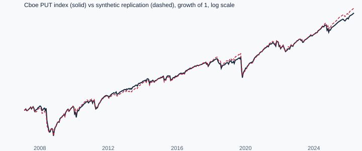

# Synthetic put-write vs the Cboe PUT index

Generated by `scripts/validate_put.py` on data through 2026-10-16. Daily PUT history is complete from mid-2007, so the comparison starts 2007-06-15.

Gate (design §4): monthly-return correlation ≥ 0.9 and CAGR within ±1.5 points a year.

## Full period

| ATM vol = VIX × | Months | Monthly corr | CAGR synthetic | CAGR PUT | Difference | Tracking error | Max drawdown synthetic / PUT | Gate |
| --- | --- | --- | --- | --- | --- | --- | --- | --- |
| 1.00 | 232 | 0.967 | 10.52% | 7.18% | +3.35 pts | 2.76% | 34.1% / 37.1% | fail |
| 0.90 | 232 | 0.969 | 7.58% | 7.18% | +0.40 pts | 2.67% | 36.3% / 37.1% | pass |

## Split-sample check of the vol ratio

The ratio is chosen on one half of the data (closest CAGR) and tested on the other half.

| Fit on | Best ratio | Test on | Test corr | Test CAGR difference | Gate |
| --- | --- | --- | --- | --- | --- |
| 2007–2016 | 0.90 | 2017–now | 0.978 | +0.92 pts | pass |
| 2017–now | 0.87 | 2007–2016 | 0.968 | -1.02 pts | pass |

## Reading this

- Using VIX itself as at-the-money vol overstates put-selling returns. VIX averages variance across all strikes, including expensive out-of-the-money puts, so it sits above at-the-money implied vol. That makes the synthetic premium too rich.
- Scaling VIX by 0.9 removes most of that bias, and the ratio carries across the two halves. 0.9 is the model default; it was chosen on 2007–2016 and holds on 2017–now.
- Independent support: Carr & Wu (2006) find the new VIX averages about 2 vol points above a bias-corrected at-the-money measure (VXOA). At a typical VIX of 18–22 that is a ratio of 0.89–0.91. VIX averages out-of-the-money puts and calls weighted by 1/K² (Cboe methodology), which is why it exceeds at-the-money vol.
- Remaining differences: expiry settles at the close instead of the morning opening print, the strike is exactly at the money instead of the listed strike, and Cboe's collateral rules (1- and 3-month bills) differ slightly from the 3-month rate used here.
- The index has no trading costs. Backtests of real trading add a bid-ask cost (S10).

## Sources

- [Cboe PutWrite index daily history](https://cdn.cboe.com/api/global/us_indices/daily_prices/PUT_History.csv), [SPX](https://cdn.cboe.com/api/global/us_indices/daily_prices/SPX_History.csv), [VIX](https://cdn.cboe.com/api/global/us_indices/daily_prices/VIX_History.csv); [FRED DTB3](https://fred.stlouisfed.org/series/DTB3)
- [Carr & Wu (2006), A Tale of Two Indices](https://engineering.nyu.edu/sites/default/files/2021-03/carrwutaleoftwoindices.pdf)
- [Cboe VIX methodology](https://cdn.cboe.com/resources/vix/VIX_Methodology.pdf)
- [Cboe on the Bondarenko PUT study](https://www.cboe.com/insights/posts/white-paper-shows-volatility-risk-premium-facilitated-higher-risk-adjusted-returns-for-put-index/)
